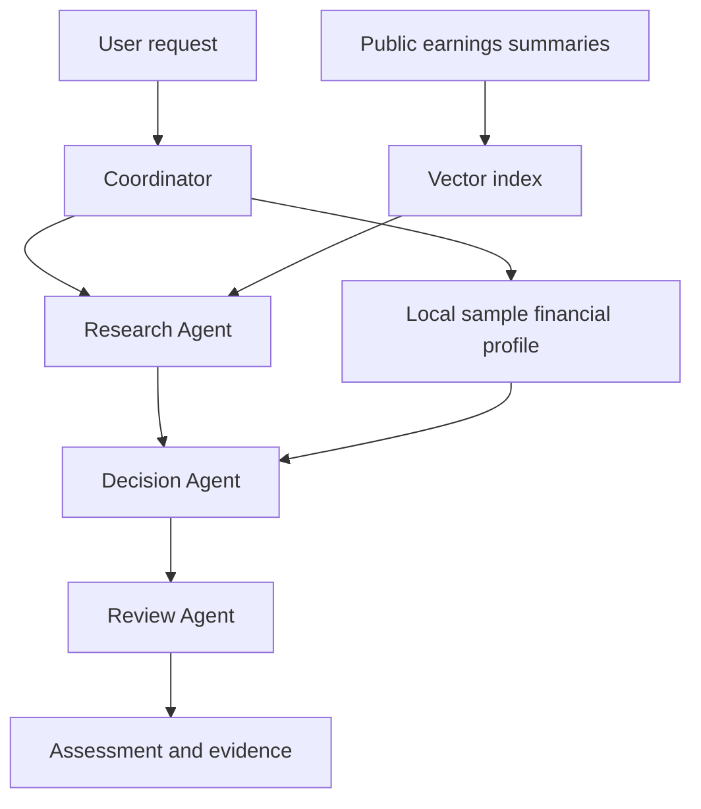

# AI-Powered Portfolio Intelligence Agent

A working local educational prototype for portfolio decision support, upgraded from the original sample-company project. It uses actual historical earnings data from NVIDIA and Microsoft, sample investor profiles, a four-role workflow, retrieval, bounded decision alternatives and financial safety checks. No trades, bank access, real user information, or current market recommendations.

## Quick start (macOS)

Extract the ZIP into a new directory, then open Terminal in that directory. If the previous server is running, stop it with Ctrl+C first.

```bash
python3 -m venv .venv
source .venv/bin/activate
python3 -m pip install -r requirements-dev.txt
python3 web_demo.py
```

Open http://127.0.0.1:8765. The offline mode is the default and needs no API key. For automated tests, open a second terminal in the project directory, activate the environment, and run `python3 -m pytest -q`. `python3 run_demo.py` generates the reproducible console outputs and JSON trace.

## Enable live AI (optional; recommended for the presentation)

An OpenAI API account, active API billing/credits and an API key are required. A ChatGPT subscription alone is not API credit. Create a key at https://platform.openai.com/api-keys. Stop the running web server, then in the same Terminal use this zsh command to enter the key without printing it:

```bash
read -s 'OPENAI_API_KEY?OpenAI API key: '; echo
export OPENAI_API_KEY
python3 web_demo.py
```

In the browser choose **Live AI • OpenAI API** and press **Run analysis**. Look for both `OpenAI dense semantic embeddings` and `Live model response; cited quotations checked`. The default language model is `gpt-4.1-mini` and the embedding model is `text-embedding-3-small`. An alternative compatible model can be selected via `export OPENAI_MODEL=...`. The API can incur costs. Never paste the key into source files, the browser UI, GitHub, slides or recordings. The API client sends only public company evidence and a company research query; investor profiles, balances and allocations are calculated locally. If the API is unavailable, the UI explicitly labels fallback rather than simulating an LLM response. The live endpoint requires your credentials; only mocked API paths were tested in the delivered package.

## Recommended recording sequence

Use **Offline • reproducible** for the following controlled replay. Historical dates are deliberate; they are not current prices or current financial advice.

| Scenario | Steps | Expected result |
|---|---|---|
| Baseline | Reset to NVIDIA Q1; Profile A, NVDA, $2,000, $0 expense | $6,000 modeled capacity; $2,000 for further review |
| Personalization | Change to Profile B | $0 capacity; wait/review |
| Retrieval update | Return to A; click Index NVIDIA Q2 report | New report dated Aug 24, 2022; growth 3% vs 46%; wait/review |
| Unexpected expense | Reset to NVIDIA Q1; enter $5,000 expense | $1,000 capacity; smaller $1,000 for review; human review flag |
| Generative AI | With valid API credentials, choose Live AI and analyze NVIDIA; show model observations and source IDs | Dense retrieval + real model evidence analysis; stance may be more cautious; no guaranteed fixed model output |

Microsoft is a second historical research example. Its report is from July 2024, not the same replay date as NVIDIA. The baseline policy is intentionally simple and is not a financial forecast. Click Official source to inspect the original earnings release.

## Architecture



- **Coordinator:** validates inputs, fetches the investor-specific profile and manages execution.
- **Research:** ticker-filtered top-3 vector retrieval, mandatory latest report, deterministic financial signal. Live AI mode optionally embeds passages and interprets the retrieved evidence using a language model. The model supplies a stance and observations linked to exact source snippets. Exact-quote validation is a basic grounding check, not proof that every interpretation is correct. A caution stance can tighten, never relax, the baseline decision policy.
- **Decision:** compares three alternatives (full amount, half amount, wait) using deterministic scores, retaining two finalists. This bounded candidate search is inspired by Tree of Thought, not unrestricted LLM reasoning or a multi-depth search.
- **Review:** checks modeled cash, portfolio concentration, horizon and risk signals; flags missing evidence, limited capacity or unavailable requested AI. Final actions remain with a human. No execution tools exist.

The local vector index uses TF-IDF/cosine offline and OpenAI dense embeddings/cosine in live mode; document embeddings are cached in memory until the index changes. Ingestion indexes prepackaged sections from public releases. It is manual/reproducible, not a live news or SEC crawler. Financial values are structured JSON. The policy evaluates hypothetical investment capacity, not suitability or future returns.

## Data provenance

`data/documents.json` contains curated, paraphrased sections from these publicly available earnings announcements (not complete filings):

- NVIDIA, May 25, 2022: https://nvidianews.nvidia.com/news/nvidia-announces-financial-results-for-first-quarter-fiscal-2023
- NVIDIA, August 24, 2022: https://nvidianews.nvidia.com/news/nvidia-announces-financial-results-for-second-quarter-fiscal-2023
- Microsoft, July 30, 2024: https://www.microsoft.com/en-us/investor/earnings/fy-2024-q4/press-release-webcast

`data/users.json` contains invented investor balances, commitments and risk preferences; no sensitive user data.

## Evaluation and limitations

Eleven automated tests cover personalization, document ingestion and deduplication, reserve limits, missing/invalid amounts, isolation of profile calculations, source inclusion, mock model caution, mock API failure and rejection of unsupported evidence quotes. They do not measure financial forecast accuracy or establish suitability. A local HTTP smoke test was performed. Real API execution still requires a test with your own API credentials. Optional Streamlit dashboard (`python3 -m pip install -r requirements-streamlit.txt; streamlit run app.py`) is not the reference demo and has not been tested.

Production evolution: automated authorized filings/news ingestion and freshness controls; persistent vector store; redundant workflow execution; authentication, encryption and tenant-scoped profiles; independent public company caches; stronger evaluation, monitoring, model validation and legal/compliance review. Do not expose the local demo server to the internet as a production service. It has shared replay state, no authentication, and no production isolation.

## Publish on GitHub

Create an empty repository at https://github.com/new. From this extracted project folder, use:

```bash
git init
git add .
git commit -m "CMU portfolio agent capstone"
git branch -M main
git remote add origin https://github.com/YOUR-USERNAME/YOUR-REPOSITORY.git
git push -u origin main
```

Git may require authentication. Alternatively upload the project files using GitHub's web UI. Do not upload `.venv`, `.env`, or any secret. Verify the actual repository URL in a browser and insert it on the final presentation slide. No repository has been published by this download.
